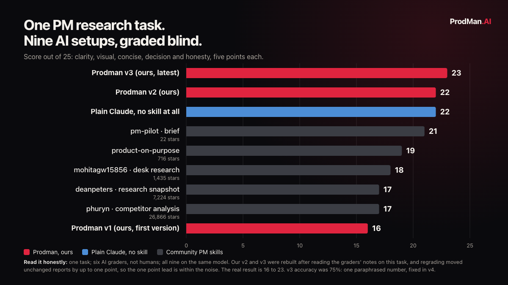

# ProdMan.AI · stop collecting AI tools

**Free, open source AI skills for product managers. Describe a PM problem in plain words; one skill
picks the right specialist skills, runs them in order, checks the result and tells you what still
needs your judgment.** Every skill here ships the frozen tests it must pass, and every scored run
is published, failures included.

```text
/prodman:pm  I have 20 messy product docs. Find the conflicting requirements
             and tell me what to build first next quarter.
```

[Install in two commands](#install) · [What is inside](#what-is-inside) · [The proof](#the-proof) ·
[Workflows](workflows/INDEX.md) · [Resources](resources/README.md) · [Roadmap](https://prodman.ai/roadmap) ·
[Free community](https://prodman.ai/join)

---

## Install
You need [Claude Code](https://code.claude.com/docs/en/overview).

**As a plugin (recommended).** Inside Claude Code:

```text
/plugin marketplace add aragjha/prodman-stack
/plugin install prodman@prodman-stack
```

Then, in any project, describe your problem or type `/prodman:pm`.

**Or clone it and work inside the folder:**

```bash
git clone https://github.com/aragjha/prodman-stack
cd prodman-stack
claude
```

The folder's `CLAUDE.md` loads [PM.md](PM.md) at the start of every session, so the standards are
in place before you type anything.

**First ten minutes, worth it:** copy [context/PRODUCT.template.md](context/PRODUCT.template.md) to
`context/PRODUCT.md` and fill it in. A skill that knows your users and the metric you are measured
on asks fewer questions and guesses less. Your context files never leave your machine.

---

## What is inside
| Part | What it does |
|---|---|
| [skills/pm](skills/pm/SKILL.md) | **The entry point.** Turns your request into a decision, routes it to a workflow, runs the skills, checks the result |
| [PM.md](PM.md) | The PM standards every skill reads first: evidence rules, templates, rubric, human checkpoints, privacy |
| [workflows/INDEX.md](workflows/INDEX.md) | PM use cases, each with inputs, the skills it combines, steps, checks and an honest tested status |
| [resources/README.md](resources/README.md) | Outside PM skill collections, scored and licence checked, that the workflows can call |
| [skills/product-research](skills/product-research/SKILL.md) | Research a product decision: argues against your belief first, checks every quote, makes the call |
| [skills/launch-minimum](skills/launch-minimum/SKILL.md) | The eight things that must exist before a launch, and nothing else |
| [skills/portfolio-from-work](skills/portfolio-from-work/SKILL.md) | Turns confidential PM work into de-identified case studies you can send |
| [skills/deidentify](skills/deidentify/SKILL.md) | Strips employers, customers and traceable numbers from anything that leaves your machine |
| [skills/eval-write](skills/eval-write/SKILL.md) | Writes the five frozen inputs a skill has to survive, before the skill exists |
| [evals/](evals/README.md) | Golden sets, scoreboards and benchmarks, failures left on them |
| [context/](context/README.md) | Templates for your product, decisions and corrections. Yours stay local |

---

## The proof
**We test in public, including when we lose.**



On one PM research task, graded blind by six separate AI graders, with all nine setups on the same
model, plain Claude with no skill scored 22 out of 25 and beat all five community PM research skills
we tested (17 to 21). Our own first version came last at 16. Rebuilt twice after reading the graders'
notes, version 3 scored 23. Read that honestly: it is one task, the graders were AI sessions rather than
people, a one point lead is inside the grading noise, and version 3 paraphrased one number (accuracy 75
percent), which version 4 fixes. Full method and every score: [the benchmark](evals/benchmarks/2026-10-11-research-head-to-head.md).

Every skill also has a golden set, five inputs built to make it fail, with the trap in each one
written down. Scores land in [evals/scoreboards](evals/scoreboards/README.md) with the failures left
on them. The `product-research` skill scored 1 out of 5 on its first run, and that is published too.

---

## What this repo cannot do
Stated plainly, because you will hit these by day three and they are not bugs.

| | |
|---|---|
| **It does not remember you across projects on its own** | Your context files help inside one folder. Anything you do not write down is forgotten when the session closes |
| **It cannot reach your tools unless you connect them** | Workflows that need Jira, Linear or analytics data say so before they start, and work only from what you give them |
| **Its check is not a reviewer** | A separate reader checks the result against your inputs and a script seals it, but it is the same model, and graded runs show it still misses things ([scoreboard](evals/scoreboards/pm.md)). A score you publish should come from someone else |
| **It does not save time you have not measured** | We cover tasks. We do not claim hours saved, because nobody has measured them yet |

The paid [ProdMan OS](https://prodman.ai/os) is where memory across projects and
scored runs on your own work are being built. This repo stays free under MIT either way.

---

## Contributing
New workflows and skills are welcome, on one condition: they arrive with their golden set. Write the
five adversarial inputs first ([eval-write](skills/eval-write/SKILL.md) helps), then the skill, then
open a pull request with one scored run attached. A skill nobody can fail does not get merged.

Found a wrong number, a dead link or a skill that misbehaved? Open an issue with the output.

---

## Community and roadmap
- **Free community:** a WhatsApp group for PMs who build with AI. [prodman.ai/join](https://prodman.ai/join)
- **Roadmap, with honest statuses:** [prodman.ai/roadmap](https://prodman.ai/roadmap)
- **Credits:** outside resources are linked, never copied, with their licences in [resources/README.md](resources/README.md).

Built by Anurag Jha, a product manager who builds agents for real PM work and publishes
what breaks as well as what works. MIT licensed: fork it, use it commercially, no attribution needed.
